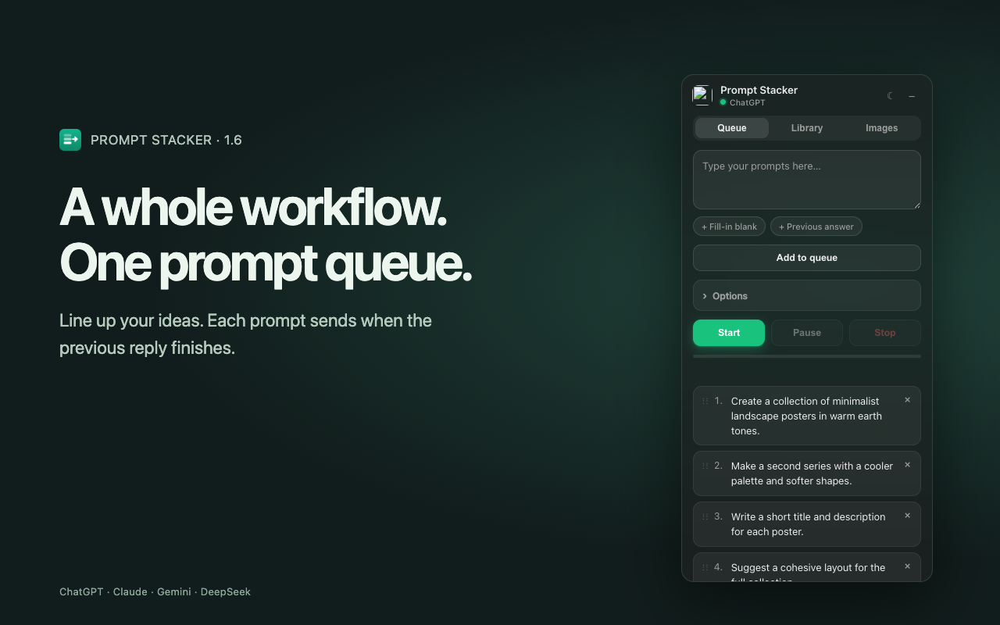
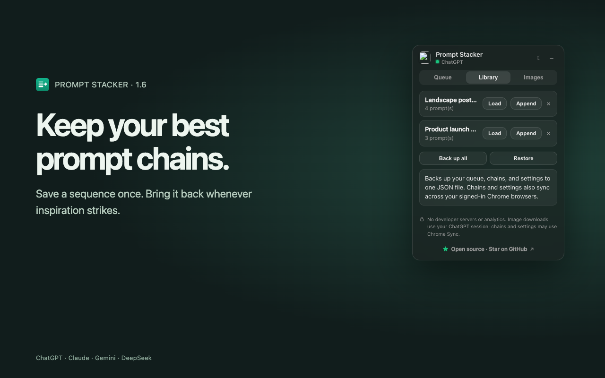
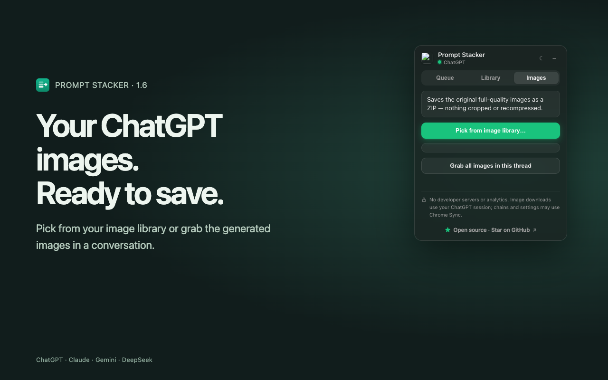
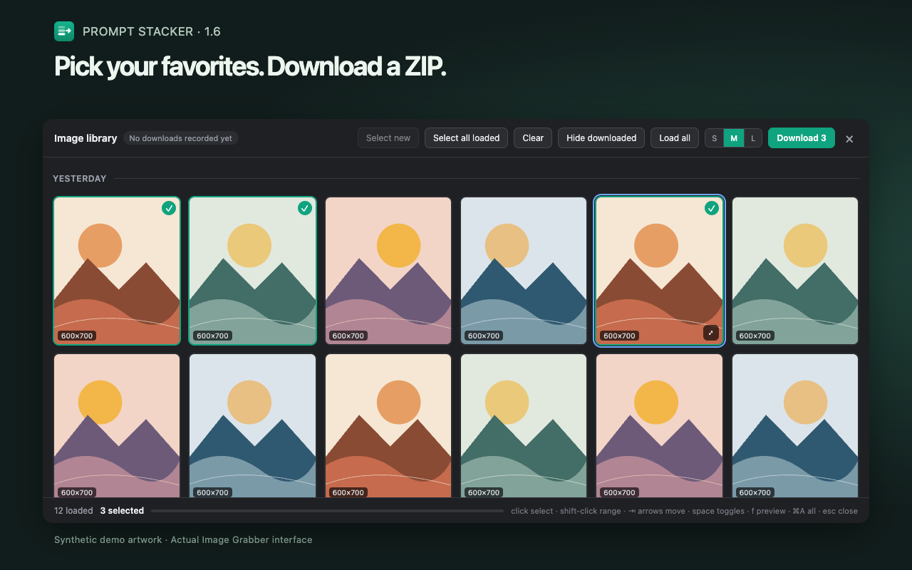
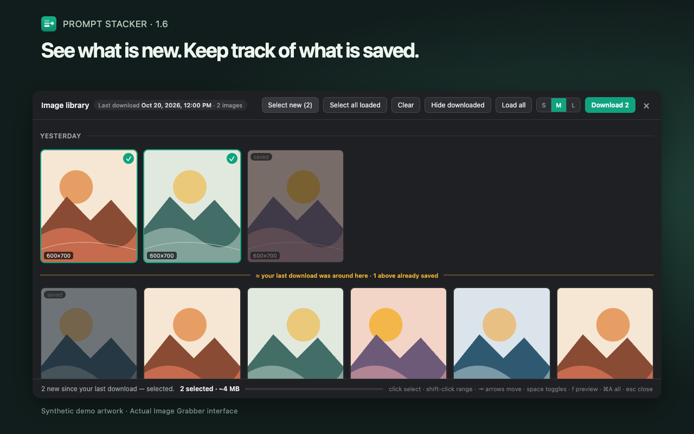

<div align="center">


# Prompt Stacker

## [➜ Install free from the Chrome Web Store](https://chromewebstore.google.com/detail/aghgmpdcceanccchafaacmdefmohkame)

**Available now on the Chrome Web Store — no developer mode needed.**

**Queue your prompts, reuse your workflows, and save your ChatGPT images.**

Version **1.6.0** is prepared in this branch. The image features reach Chrome Web Store users after the update passes review and is published.

Works on **ChatGPT · Claude · Gemini · DeepSeek**. No more babysitting the tab — line up your prompts, hit **Start**, walk away.

[](https://chromewebstore.google.com/detail/aghgmpdcceanccchafaacmdefmohkame)
[](LICENSE)

*No developer account · No developer servers or analytics · Open source*



</div>

---

## Why

You often have a *sequence* of prompts for one conversation — a lesson plan, a research thread, a multi-step draft. Normally you sit there waiting for each reply so you can paste the next one. Prompt Stacker does the waiting and the clicking for you.

The queue places your prompts in the open chat and clicks **Send** when the reply is done. On ChatGPT, the **Images** tab can also browse and download generated images using your existing signed-in session. Image files are downloaded from ChatGPT and its image hosts; no developer service receives your content.

## Supported platforms

| Platform | URL | Status |
| --- | --- | --- |
| ChatGPT | chatgpt.com | ✅ Verified |
| Claude | claude.ai | ✅ Verified |
| Gemini | gemini.google.com | ✅ Verified |
| DeepSeek | chat.deepseek.com | 🧪 Best-effort (pending live verification) |

Each platform's selectors live in a single `ADAPTERS` block in `content.js` — adding a new site or fixing a drifted selector is a one-place change.

## New in 1.6.0: ChatGPT Images

- **Image library picker** — browse generated images in a grid, select a batch and preview individual images.
- **ZIP downloads** — save selected images with an `index.tsv` containing their metadata. Image bytes are preserved without cropping or re-encoding.
- **Current conversation** — grab generated images from the current conversation branch while excluding uploaded references.
- **Saved-image tracking** — saved badges, a download watermark, **Select new**, and **Hide downloaded** help you avoid repeating downloads.
- **Failure recovery** — failed items remain available for retry. Failed-download details are retained in the ZIP index when a batch partly succeeds.
- **Large batches** — archives split at a 250 MiB image-payload threshold. A part can exceed that threshold by an image and ZIP overhead; Chrome may ask you to allow multiple downloads.
- **Queue coordination** — image jobs and the prompt queue take turns. Pause the queue before downloading; resume after the image job finishes.

The image features require a signed-in ChatGPT session. They are disabled on Claude, Gemini and DeepSeek. Session access stays in tab memory; no password or API key needs to be entered into the extension.

## Features

- 🧱 **Prompt queue** — stack as many prompts as you like; the next one sends automatically when the current reply finishes.
- ✅ **Confirmed sends** — verifies that each prompt was accepted, safely retries once, and pauses with Retry / Skip controls instead of silently advancing.
- 🌐 **Four platforms** — one extension for ChatGPT, Claude, Gemini, and DeepSeek.
- 🎯 **Platform-aware** — detects which AI you're on and tints the whole panel to its brand colour (ChatGPT green, Claude clay, Gemini blue-violet, DeepSeek indigo), with a live "detected" badge.
- 🔗 **Chain replies** — use `{{last_reply}}` to feed the AI's previous answer straight into the next prompt (*“Now summarise the above”*).
- 🎨 **Auto theme** — follows the site's light/dark mode automatically (or lock it to light/dark yourself).
- ⏱️ **Delay between prompts** — add a breather so you can read each reply before the next fires.
- ⏸️ **Pause / Resume / Stop** — full control mid-run; pause takes effect after the current reply.
- 🔀 **Reorder & edit** — drag to reorder, double-click to edit a queued prompt.
- ↩️ **Undo mistakes** — restore a removed prompt or an accidentally cleared queue for seven seconds.
- 📚 **Saved chains** — save a sequence you reuse and load it with one click.
- 🔤 **Variables** — write `{{topic}}` in your prompts and fill them in once at run time.
- 🔁 **Repeat** — run the whole queue N times (great for generating variations).
- ▶️ **Auto-continue** — clicks *“Continue generating”* when a reply gets truncated.
- 🛑 **Limit-aware** — optionally auto-pauses if ChatGPT shows a usage-limit warning.
- 💾 **Backup & sync** — one-file JSON backup/restore; chains and settings sync across your signed-in Chrome browsers.
- ⌨️ **Keyboard shortcuts** — start/stop, pause, and collapse without touching the mouse.
- 📌 **Compact by default** — opens as a tidy draggable pill with a queue count and expands only when you click it.
- 👋 **Friendly first run** — a short guide explains prompt stacks and can load an editable three-step example.
- 📐 **Viewport-safe panel** — adapts to small windows, scrolls internally, and stays within the visible browser area while dragging.
- 📍 **Remembers its position** — the compact pill and expanded panel each keep their own position on every supported platform, even after a page refresh.

## Screenshots

These show the actual extension interface with synthetic prompts, history and geometric artwork. They contain no personal chats, account screenshots or real-user images.

| Queue | Saved prompt chains |
| :---: | :---: |
|  |  |







## Install

**[➜ Add to Chrome — free, from the Chrome Web Store](https://chromewebstore.google.com/detail/aghgmpdcceanccchafaacmdefmohkame)**

One click, no developer mode, auto-updates. Works in Chrome, Edge, Brave, Arc and any Chromium browser.

<details>
<summary>Or install unpacked (for development)</summary>

1. **Download** this repo (green **Code** button → *Download ZIP*, then unzip) or `git clone` it.
2. Open **`chrome://extensions`** in Chrome.
3. Turn on **Developer mode** (top-right).
4. Click **Load unpacked** and select the project folder.
5. Open any [supported platform](#supported-platforms) (e.g. [chatgpt.com](https://chatgpt.com)) — the **Prompt Stacker** panel appears top-right. Refresh if it doesn't.

</details>

## How to use

1. Type your prompts into the box, one per block. **Separate each prompt with a blank line** or a line containing only `---`.
2. Click **Add to queue**.
3. (Optional) Open **Options** to set a delay, repeat count, or toggles.
4. Click **Start**. Sit back.

### Save ChatGPT images

1. Open ChatGPT and expand Prompt Stacker, then choose **Images**.
2. Pause any running prompt queue.
3. Choose **Pick from image library…**, select images, then click **Download**. Alternatively, choose **Grab all images in this thread** from a conversation with generated outputs.
4. Allow multiple downloads if Chrome asks during a large batch. Check all ZIP parts, including any final index-only failure report.
5. Review `index.tsv` for metadata or failed downloads. ZIP indexes can contain prompts, so review archives before sharing them.

**Select new** compares loaded image timestamps against your last download watermark and excludes remembered saved IDs. It becomes available after your first successful download. It is not a list of every older image you ever skipped; use **Hide downloaded** to find older unsaved items.

Inside the picker, use the arrow keys to move, **Space** to select, **F** to preview, and **Esc** to close the preview or picker. Prompt queue shortcuts stand down while the picker is open.

### Prompt format

```text
Explain the German dative case with three example sentences.

Create an A1-level vocabulary list about {{topic}}.

Write a short dialogue using those words.
```

- A **blank line** (or `---`) separates prompts, so a single prompt can span multiple lines.
- `{{topic}}` is a **variable** — you'll be asked to fill it in once when you press Start, and it's substituted everywhere.
- `{{last_reply}}` is **dynamic** — it's replaced at send time with ChatGPT's most recent answer, so each prompt can build on the last one. (Aliases: `{{last_response}}`, `{{previous}}`.)

### Keyboard shortcuts

| Shortcut | Action |
| --- | --- |
| `⌘/Ctrl + Enter` (in the box) | Add prompts to the queue |
| `⌘/Ctrl + Shift + S` | Start / Stop |
| `⌘/Ctrl + Shift + P` | Pause / Resume |
| `⌘/Ctrl + Shift + H` | Collapse / expand the panel |
| `Esc` | Close a dialog |

### Options

| Option | What it does |
| --- | --- |
| **Delay between prompts** | Wait N seconds after a reply finishes before sending the next. |
| **Repeat whole queue ×** | Run the entire queue this many times in a row. |
| **New chat before each prompt** | Send each prompt in a fresh conversation instead of one thread. |
| **Auto-click “Continue generating”** | Finish long, truncated replies before moving on. |
| **Auto-pause on usage-limit warning** | Stop cleanly if ChatGPT says you've hit a limit. |

## Privacy

Prompt Stacker requests the **`storage`** permission and runs on the supported AI chat sites. Your working queue is stored locally; saved chains and settings may use your own Chrome Sync account. Starting a queue sends those prompts to the AI service you use.

The image tools request your session, generated-image metadata and image files from ChatGPT and its existing image hosts over HTTPS. Session tokens stay in tab memory. Download history is stored locally, and image ZIPs are saved on your device. No developer servers, analytics or advertising trackers receive your prompts, replies, images or credentials.

Downloaded ZIP indexes and exported prompt backups can contain private prompts and metadata. Review them before sharing. See the full [privacy policy](PRIVACY.md).

## Development

```bash
npm test                    # parsing, position, coordination, history and thread regressions
node test/verify-archives.cjs # real 250 MiB split, CRCs and byte-integrity checks (large temporary files)
python3 test/release-privacy.py # package-input and unpublished-history privacy scan
```

To check dragging, collapse/expand, and refresh recovery in a real browser, serve
the project locally and open `test/position.html`. It uses isolated test storage,
so it cannot change your installed extension's queue or library.

Generate the synthetic store screenshots with Playwright in a fresh offline browser:

```bash
PLAYWRIGHT_MODULE=/path/to/playwright QA_CHROME=/path/to/chrome node test/store-shots.cjs
```

The renderer intercepts all requests locally and never opens your personal Chrome profile. Output and provenance are under `store/v1.6/`.

**Project layout**

```
manifest.json      Manifest V3 and content-script site access
content.js         panel, prompt queue and saved chains
panel.css          panel styling
busy-lock.js       shared queue/image job coordination
images-tab.js      Images tab entry points
library.js         image picker, paging and download history
thread.js          current-conversation original-image resolution
grabber.js         image fetching, ZIP parts and failure reporting
zip-lib.js         ZIP encoding
icon*.png          extension icons
test/              regression tests, browser fixtures and release audit
store/v1.6/        synthetic store screenshots and provenance
```

## Contributing / Star

If this saves you some clicks, **a ⭐ would be much appreciated** — it genuinely helps. Issues and PRs welcome.

## License

[MIT](LICENSE) © thegreatLUCY
